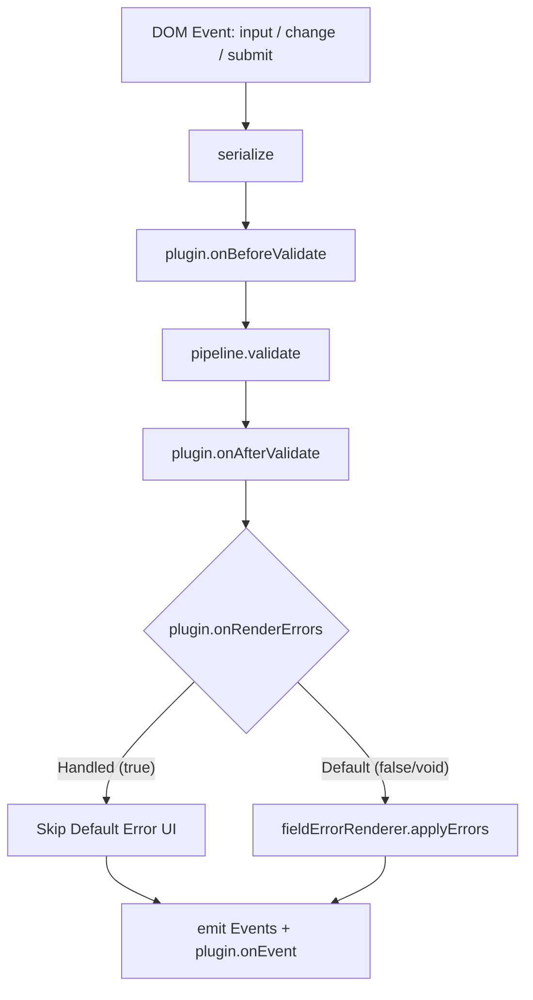

# RFC 001: Runtime Extension Points (Plugins & Middleware)

- **Issue**: [NF-011](file:///d:/workspace/projects/native-form/docs/ISSUE_BACKLOG.md#L265-L282)
- **Status**: Proposed
- **Target Version**: v0.7.0 / v1.0.0
- **Author**: Antigravity Core Team

---

## 1. Summary

This RFC proposes a lightweight, backward-compatible extension model for `Runtime` in `@native-form/core`. It introduces formal extension hooks around the core execution pipeline:

```text
serialize ──> validate ──> render ──> emit
```

The extension model enables common enterprise and product workflows (e.g., input masking, auto-saving drafts, custom error tooltips, analytics telemetry, and mutation policies) without compromising the zero-registration, native-HTML-first philosophy.

---

## 2. Motivation & Use Cases

Currently, `Runtime` orchestrates form lifecycles as a single cohesive unit. While this guarantees deterministic behavior, consumers with specialized needs must either patch `Runtime` options or duplicate wiring outside the form boundary.

Key use cases:
1. **Value Transformations**: Normalizing casing, trimming whitespace, or masking telephone/credit card numbers before validation.
2. **Custom Error Presentation**: Delegating inline error display to external design-system components (e.g., Radix Popovers, custom floating tooltips, or toast notifications) while suppressing native DOM insertion.
3. **Form Persistence / Drafts**: Auto-saving form state to `localStorage` or an IndexedDB cache on `field:change`, with rehydration on mount.
4. **Product Analytics**: Seamlessly sending events to tracking providers (Datadog, PostHog, Segment) on field interaction and validation errors.

---

## 3. Architecture Guardrails

Per [`docs/ISSUE_BACKLOG.md`](file:///d:/workspace/projects/native-form/docs/ISSUE_BACKLOG.md#L485-L493) and [`docs/DESIGN.md`](file:///d:/workspace/projects/native-form/docs/DESIGN.md), this design explicitly **avoids**:
- Dependency injection (DI) containers or factory hierarchies.
- Standalone `EventBus` or Service Locator layers.
- Splitting `Runtime` into multiple services or micro-classes.
- Introducing mandatory abstractions that add overhead for standard forms.

Plugins and middleware are **purely optional opt-in hooks**.

---

## 4. API Design Sketch

### 4.1 Plugin Contract

A plugin is a plain object with optional lifecycle hooks:

```ts
/** @public */
export interface RuntimePlugin<
  TValues extends NativeFormValues = NativeFormValues,
> {
  name: string;

  /** Called when the Runtime is mounted to a form element */
  onMount?(context: PluginMountContext<TValues>): void;

  /** Called when the Runtime is unmounted */
  onUnmount?(): void;

  /** Hook to inspect or transform serialized values before validation */
  onBeforeValidate?(
    values: NativeFormFlatValues,
  ): NativeFormFlatValues | Promise<NativeFormFlatValues>;

  /** Hook to inspect or augment validation results before error projection */
  onAfterValidate?(
    result: ValidationResult<TValues>,
  ): ValidationResult<TValues> | Promise<ValidationResult<TValues>>;

  /**
   * Hook to customize error rendering.
   * Return `true` to indicate the plugin handled error rendering,
   * suppressing default DOM error element insertion.
   */
  onRenderErrors?(
    errors: Record<string, string>,
    fields: FieldNode[],
  ): boolean | void;

  /** Hook called for every emitted RuntimeEvent */
  onEvent?(event: RuntimeEvent): void;
}

export interface PluginMountContext<
  TValues extends NativeFormValues = NativeFormValues,
> {
  form: HTMLFormElement;
  runtime: RuntimePublicApi<TValues>;
}
```

### 4.2 Runtime Configuration

`RuntimeOptions` gains an optional `plugins` array:

```ts
export interface RuntimeOptions<TValues extends NativeFormValues = NativeFormValues> {
  // Existing options:
  schema?: SchemaLike<TValues>;
  validator?: Validator<TValues>;
  pipeline?: ValidationPipeline<TValues>;
  onSubmit?: (values: TValues, event?: SubmitEvent) => void | Promise<void>;
  onInvalid?: (errors: Record<string, string>, values: NativeFormValues, event?: SubmitEvent) => void;

  // New extension point:
  plugins?: RuntimePlugin<TValues>[];
}
```

---

## 5. Lifecycle Flow Integration

The execution pipeline hooks integrate into `Runtime` private flow methods (`processInputFlow`, `processChangeFlow`, `processSubmitFlow`):



### 5.1 Pipeline Isolation & Error Safety
A crashing plugin must never break native form submission or leave the form in an unusable state.
All plugin hooks are wrapped in `try...catch` boundaries:
- If `onBeforeValidate` throws, `Runtime` logs a console warning and proceeds with untransformed values.
- If `onRenderErrors` throws, `Runtime` falls back to default `FieldErrorRenderer`.
- If `onEvent` throws, `Runtime` logs a warning without interrupting internal listener dispatch.

---

## 6. Practical Plugin Examples

### Example A: LocalStorage Persistence Plugin

```ts
export function createDraftPersistencePlugin(key: string): RuntimePlugin {
  return {
    name: "draft-persistence",
    onMount({ form, runtime }) {
      const saved = localStorage.getItem(key);
      if (saved) {
        try {
          const values = JSON.parse(saved);
          // Pre-populate native inputs
          for (const [name, val] of Object.entries(values)) {
            const el = form.elements.namedItem(name) as HTMLInputElement | null;
            if (el && typeof val === "string") {
              el.value = val;
            }
          }
        } catch (_err) {
          // ignore corrupted drafts
        }
      }
    },
    onEvent(event) {
      if (event.type === "field:change" || event.type === "field:update") {
        localStorage.setItem(key, JSON.stringify(event.values));
      }
      if (event.type === "form:submit" || event.type === "form:reset") {
        localStorage.removeItem(key);
      }
    },
  };
}
```

### Example B: Custom Design-System Tooltip Announcer

```ts
export function createTooltipPlugin(announce: (field: string, msg: string) => void): RuntimePlugin {
  return {
    name: "custom-tooltips",
    onRenderErrors(errors) {
      for (const [field, message] of Object.entries(errors)) {
        announce(field, message);
      }
      // Return true to prevent default DOM inline label injection
      return true;
    },
  };
}
```

---

## 7. Migration Strategy & Compatibility

1. **Zero Breaking Changes**: The `plugins` array is completely optional. If omitted, `Runtime` operates identically to current behavior with zero overhead.
2. **Type Safety**: Plugins preserve the generic `TValues` schema mapping.
3. **React Adapter Integration**: `useForm({ plugins: [...] })` passes plugins directly to `Runtime` constructor.
4. **Phased Rollout**:
   - Phase 1: Implement `onEvent`, `onMount`, `onUnmount` (telemetry & lifecycle).
   - Phase 2: Implement `onBeforeValidate` and `onAfterValidate` (value mutation & validation interception).
   - Phase 3: Implement `onRenderErrors` (custom UI delegators).

