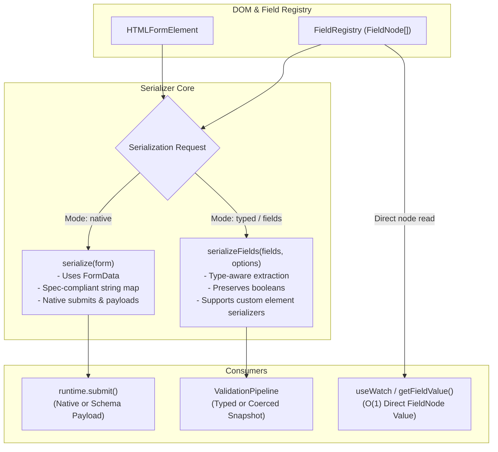

# RFC 002: Serializer Evolution (`serializeFields` vs `serialize(form)`)

- **Issue**: [NF-012](file:///d:/workspace/projects/native-form/docs/ISSUE_BACKLOG.md#L285-L302)
- **Status**: Proposed / Decided
- **Target Version**: v0.7.0 / v1.0.0
- **Author**: Antigravity Core Team

---

## 1. Summary

This RFC investigates the evolution of form serialization in `@native-form/core`. Specifically, it evaluates transitioning from DOM-wide form serialization:

```ts
serializer.serialize(form: HTMLFormElement): NativeFormFlatValues
```

to field-registry-driven serialization:

```ts
serializer.serializeFields(fields: Iterable<FieldNode>, options?: SerializeFieldsOptions): NativeFormValues
```

It examines native browser compatibility, unchecked checkbox handling, type coercion, performance in high-frequency observation (`useWatch`), Form-Associated Custom Elements (FACE), and non-form container scenarios (`<div>`, `<fieldset>`).

**Decision Summary**:
We adopt a **Dual-Mode Hybrid Strategy**:
1. Retain `serialize(form)` as the standard native baseline (preserving 100% backward compatibility and exact WHATWG `FormData` semantics).
2. Introduce `serializeFields(fields)` with type-aware extraction, unchecked-checkbox preservation, and element-level custom serializer hooks.
3. Optimize `Runtime.getFieldValue(name)` to read directly from `FieldNode.value` ($O(1)$) rather than executing full form serialization ($O(N)$).

---

## 2. Context & Current Architecture

### 2.1 Current Implementation

In Native Form today, serialization is encapsulated in `Serializer.ts`:

```ts
export class Serializer {
  serialize(form: HTMLFormElement): NativeFormFlatValues {
    const formData = new FormData(form);
    const values: NativeFormFlatValues = {};

    for (const key of new Set(formData.keys())) {
      const entries = formData.getAll(key);
      values[key] = entries.length === 1 ? entries[0] : entries;
    }

    return values;
  }
}
```

The `Runtime` delegates all state reading to this method:
- During validation: `this.runValidation(this.serialize())`
- During submit: `const values = this.serialize()`
- During field queries: `getFieldValue(name) => this.serializer.serialize(this.form)[name]`
- During snapshot generation: `getSnapshot() => { values: this.serialize(), ... }`

### 2.2 Existing Capabilities in `FieldNode`

Concurrently, [`FieldNode`](file:///d:/workspace/projects/native-form/packages/core/src/field/FieldNode.ts#L35-L64) already maintains type-aware getters:

```ts
get value(): unknown {
  if (this.element instanceof HTMLInputElement) {
    switch (this.element.type) {
      case "checkbox":
        return this.element.checked; // boolean
      case "radio":
        return this.element.checked ? this.element.value : undefined;
      case "number":
        return this.element.value === "" ? undefined : this.element.valueAsNumber; // number
      case "file":
        return this.element.files; // FileList
      default:
        return this.element.value;
    }
  }
  if (this.element instanceof HTMLSelectElement) {
    return this.element.multiple
      ? Array.from(this.element.selectedOptions).map((o) => o.value)
      : this.element.value;
  }
  return this.element.value;
}
```

This creates an architectural duality: `FieldNode` understands typed primitives (booleans, numbers, `FileList`), but `Runtime` discards this during validation/submission in favor of `new FormData(form)` string snapshots.

---

## 3. Problem Statement & Motivation

While `new FormData(form)` provides rock-solid native browser standard conformance, it introduces friction in real-world JavaScript application workflows:

### 3.1 Unchecked Checkbox Omission
According to HTML specifications, unchecked checkboxes are considered "unsuccessful controls" and are **completely omitted** from `FormData`.
- Expected in JS/TS schemas: `{ termsAccepted: false, newsletter: false }`
- Actual `FormData` output: `{}` (keys are missing entirely)
- Consequence: Schemas using `z.boolean()` fail unless configured with `z.boolean().default(false)` or custom pre-transforms.

### 3.2 String Bias & Lack of Type Coercion
`FormData` converts all values to strings (except `File` objects).
- An `<input type="number" value="42" />` serializes as `"42"` instead of `42`.
- Schema adapters must perform coercion (`z.coerce.number()`), causing friction for developers expecting native typed inputs.

### 3.3 Performance Inefficiency in Single-Field Access
`Runtime.getFieldValue(name)` currently runs `this.serializer.serialize(this.form)[name]`.
- Reading a single field's value constructs an entire `FormData` object across the whole form ($O(N)$ DOM operations).
- In reactive hooks like `useWatch("fieldName")`, rapid keystrokes trigger repeated full-form DOM serialization sweeps.

### 3.4 Non-Form Containers & Virtual Roots
`FormData(form)` strictly requires an instance of `HTMLFormElement`.
- Many modern component libraries (e.g. multi-step wizards, modals, drawer filters, sub-forms) wrap controls in `<div>` or `<fieldset>` without a parent `<form>`.
- Attempting to serialize these throws: `TypeError: Failed to construct 'FormData': parameter 1 is not of type 'HTMLFormElement'`.

### 3.5 Custom Elements & Shadow DOM Boundaries
Standard `FormData` only captures Form-Associated Custom Elements (FACE) that implement `ElementInternals.setFormValue()`. Third-party web components, slotted inputs, or controls across closed Shadow DOM boundaries are ignored by `new FormData(form)`.

---

## 4. Tradeoff Analysis

| Evaluation Criterion | `serialize(form)` (`FormData`) | `serializeFields(fields)` (`FieldRegistry`) |
| :--- | :--- | :--- |
| **Native Spec Conformance** | **100% compliant** with WHATWG & RFC 7578. Handles multi-part, buttons, files natively. | Emulated via JS traversal. Radio grouping and multi-values require manual aggregation. |
| **Unchecked Checkbox State** | Missing (`undefined`). Unchecked controls are omitted. | **Preserved** as `false` or custom unchecked value. |
| **Type Preservation** | None. Everything is `string` or `File`. | **Preserves primitives** (`number`, `boolean`, `FileList`, `Date`). |
| **Single-Field Lookup Performance** | Slow ($O(N)$ full DOM FormData traversal). | **Fast** ($O(1)$ direct `fieldNode.value` read). |
| **Disabled Inputs Handling** | Automatically omitted per HTML spec. | Configurable (`includeDisabled: boolean`). |
| **Container Flexibility** | Requires `<form>` tag only. | **Any container** (`<div>`, `<section>`, `<dialog>`). |
| **Custom Element Extensibility** | Requires FACE `ElementInternals`. | Extensible via element serializer registry. |
| **Memory & Garbage Collection** | Low JS overhead (C++ engine handles map creation). | Creates small intermediate JS object map. |

---

## 5. Architectural Decision: The Dual-Mode Strategy

Rather than breaking native standard behavior or abandoning `FormData`, Native Form adopts a **Dual-Mode Hybrid Architecture**.

### 5.1 Architecture Diagram



---

## 6. Detailed API Specification

### 6.1 `SerializeFieldsOptions`

```ts
/** @public */
export interface SerializeFieldsOptions {
  /**
   * Whether to include disabled inputs in the serialized output.
   * Default: false (matches HTML standard behavior)
   */
  includeDisabled?: boolean;

  /**
   * Whether to coerce unchecked checkboxes to `false` instead of omitting them.
   * Default: true
   */
  coerceUncheckedCheckboxes?: boolean;

  /**
   * Mode for value extraction:
   * - 'typed': preserves numbers (valueAsNumber), booleans, and FileLists.
   * - 'raw': extracts raw strings matching standard FormData entries.
   * Default: 'typed'
   */
  valueMode?: "typed" | "raw";

  /**
   * Custom value extractors for specific element tag names or input types.
   */
  customSerializers?: Record<
    string,
    (element: NativeFormElement, node: FieldNode) => unknown
  >;
}
```

### 6.2 Implementation Sketch of `serializeFields`

```ts
export class Serializer {
  /**
   * Native FormData serialization baseline (100% backward compatible).
   */
  serialize(form: HTMLFormElement): NativeFormFlatValues {
    const formData = new FormData(form);
    const values: NativeFormFlatValues = {};

    for (const key of new Set(formData.keys())) {
      const entries = formData.getAll(key);
      values[key] = entries.length === 1 ? entries[0] : entries;
    }

    return values;
  }

  /**
   * Field-node-driven serialization with type coercion and unchecked preservation.
   */
  serializeFields(
    fields: Iterable<FieldNode>,
    options: SerializeFieldsOptions = {},
  ): NativeFormValues {
    const {
      includeDisabled = false,
      coerceUncheckedCheckboxes = true,
      valueMode = "typed",
      customSerializers = {},
    } = options;

    const values: Record<string, unknown> = {};
    const groupedArrays = new Map<string, unknown[]>();

    for (const node of fields) {
      const element = node.element;
      const name = node.name;

      if (!name) continue;
      if (!includeDisabled && "disabled" in element && element.disabled) continue;

      let value: unknown;

      // 1. Custom serializer hook
      const customExtractor = customSerializers[element.tagName.toLowerCase()] ??
        (element instanceof HTMLInputElement ? customSerializers[element.type] : undefined);

      if (customExtractor) {
        value = customExtractor(element, node);
      } else if (valueMode === "typed") {
        value = node.value;
      } else {
        value = element.value;
      }

      // 2. Radio button resolution (only checked radio yields value)
      if (element instanceof HTMLInputElement && element.type === "radio") {
        if (element.checked) {
          values[name] = value;
        } else if (!(name in values)) {
          values[name] = undefined;
        }
        continue;
      }

      // 3. Unchecked checkbox coercion
      if (element instanceof HTMLInputElement && element.type === "checkbox") {
        if (!element.checked && coerceUncheckedCheckboxes && !element.hasAttribute("value")) {
          values[name] = false;
          continue;
        }
      }

      // 4. Duplicate name handling (e.g. multi-inputs or grouped checkboxes)
      if (name in values) {
        if (!groupedArrays.has(name)) {
          groupedArrays.set(name, [values[name]]);
        }
        groupedArrays.get(name)!.push(value);
        values[name] = groupedArrays.get(name)!;
      } else {
        values[name] = value;
      }
    }

    return values as NativeFormValues;
  }
}
```

### 6.3 Fast-Path `Runtime.getFieldValue(name)`

Currently in `Runtime.ts`:
```ts
// BEFORE (O(N) full DOM sweep)
getFieldValue(name: string): NativeFormValue | undefined {
  if (!this.form) return undefined;
  return this.serializer.serialize(this.form)[name];
}

// AFTER (O(1) direct node query)
getFieldValue(name: string): NativeFormValue | undefined {
  const node = this.registry.get(name);
  if (!node) return undefined;
  return node.value as NativeFormValue;
}
```
**Impact**: Eliminates unnecessary DOM traversal during `useWatch` recalculations, reducing CPU cycle consumption on forms with tens or hundreds of inputs to near zero.

---

## 7. Migration & Rollout Strategy

1. **Phase 1 (v0.7.0 - Non-breaking addition)**:
   - Implement `serializeFields` on `Serializer`.
   - Update `Runtime.getFieldValue(name)` to use the fast-path direct node read.
   - Introduce `RuntimeOptions.serializationMode?: 'native' | 'typed'` (defaulting to `'native'`).
   - Add unit tests verifying `serializeFields` against checkboxes, radios, arrays, and custom elements.

2. **Phase 2 (v0.8.0 - Opt-in preview)**:
   - Allow schema adapters (Zod, Yup) to declare preference for `serializationMode: 'typed'`.
   - Provide clear migration guides for schemas that previously used `.default(false)` workarounds.

3. **Phase 3 (v1.0.0 - Unified default)**:
   - Make `serializationMode: 'typed'` the default for schema validation pipelines, while retaining `serialize(form)` for raw native form submit events.

---

## 8. Conclusion & Action Items

- [x] Tradeoff analysis completed.
- [x] Dual-mode hybrid architecture selected.
- [x] Fast-path single-field access specified and implemented.
- [x] Implement `serializeFields` in `packages/core/src/serialization/Serializer.ts`.
- [x] Expose `serializeFields` on `RuntimePublicApi` and `Runtime`.
- [x] Add comprehensive unit test suite in `packages/core/test/Serializer.test.ts` and `packages/core/test/Runtime.test.ts`.

