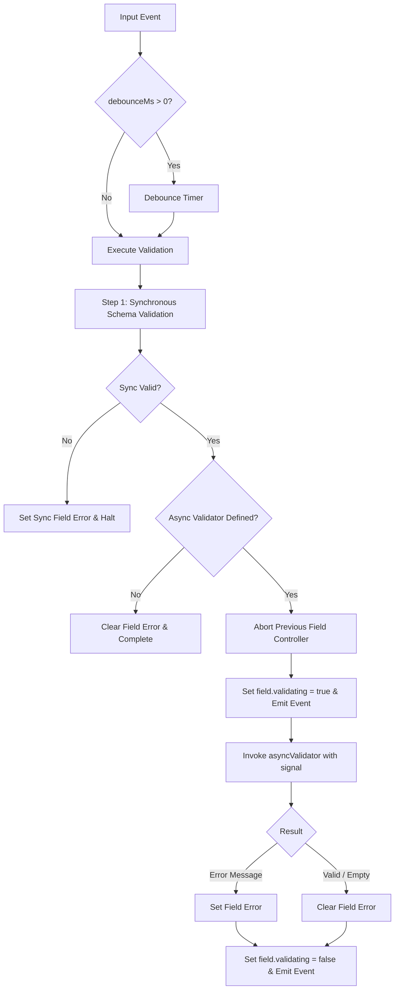

# RFC 004: Async Server-Side Validation Pipeline (NF-020)

- **Issue**: NF-020 / [ISSUE_BACKLOG.md](file:///d:/workspace/projects/native-form/docs/ISSUE_BACKLOG.md)
- **Status**: Proposed / Decided
- **Target Version**: v0.7.0
- **Author**: Antigravity Core Team

---

## 1. Summary

This RFC specifies the **Asynchronous Server-Side Validation Pipeline** for `@native-form/core` and `@native-form/react`.

Modern web applications frequently validate form fields against remote server APIs:
- Checking username or email availability (`/api/check-email?email=...`).
- Verifying coupon and discount codes.
- Validating postal codes and tax IDs against external databases.

This RFC introduces:
1. **Per-Field Validating State**: Adding `validating: boolean` to `FieldState`, `FieldNode`, and `useField()`, enabling localized loading spinners and progress indicators.
2. **Debounced Keystroke Validation**: Configurable `debounceMs` (defaulting to 0 for synchronous validations or user-specified duration such as 250ms-400ms for keystroke validation), preventing server flooding.
3. **Per-Field AbortController & Race Condition Shield**: Cancels in-flight requests automatically whenever a subsequent keystroke occurs or when the form resets or unmounts.
4. **Two-Tier Validation (Sync-First Short-Circuiting)**: Local synchronous schema validations (e.g., email syntax, min length) execute first; expensive async server checks are skipped if synchronous rules fail.
5. **Ergonomic Field-Level Async Validators**: Direct registration via `asyncValidators` in `useForm` and `RuntimeOptions`.

---

## 2. Motivation & Current Problems

### 2.1 Lack of Per-Field Loading States
Currently, `RuntimeFormState` exposes a top-level `validating: boolean` flag, but individual field states in `FieldNode` and `useField()` lack a `validating` property. A user typing in a username field has no localized visual feedback showing that remote verification is in progress.

### 2.2 Network Flooding on Keystrokes
When forms operate in `onChange` or `all` validation modes, every keystroke immediately triggers validation. For asynchronous endpoints, typing a 10-character email executes 10 successive HTTP requests, overwhelming backend services and exhausting connection limits.

### 2.3 Race Conditions from In-Flight Responses
Without scoped cancellation, an earlier network request that takes 800ms may resolve **after** a later request that completed in 200ms. The slower, stale response can overwrite the accurate, newer validation state.

### 2.4 Unnecessary Server Traffic on Invalid Inputs
Calling remote availability endpoints for syntactically malformed inputs (e.g., querying the database for `alex@` before the user finishes typing the domain) is wasteful.

---

## 3. Detailed Specification

### 3.1 Extended Types

```ts
/**
 * Asynchronous validator function for an individual field.
 * Returns an error message string if invalid, or undefined/void if valid.
 */
export type AsyncFieldValidator<TValue = unknown> = (
  value: TValue,
  context: ValidationContext,
) => Promise<string | undefined | void>;

export interface FieldState {
  name: string;
  dirty: boolean;
  touched: boolean;
  mounted: boolean;
  initialValue: NativeFormValue | undefined;
  value: NativeFormValue | undefined;
  error?: string;
  /**
   * Indicates whether this specific field is currently awaiting an
   * asynchronous validation response.
   */
  validating?: boolean;
}

export interface RuntimeOptions<
  TValues extends NativeFormValues = NativeFormValues,
> {
  // ... existing options
  /**
   * Milliseconds to debounce input-triggered validations.
   * @defaultValue 0
   */
  debounceMs?: number;

  /**
   * Dedicated field-level asynchronous validators.
   */
  asyncValidators?: Record<string, AsyncFieldValidator>;
}
```

### 3.2 Two-Tier Execution Flow



### 3.3 Cancellation & Lifecycle Semantics

1. **Per-Field Scoped Cancellation**:
   Each field with an active async validation holds a dedicated `AbortController`. If a new keystroke or blur event occurs for that field while a request is in flight:
   - `controller.abort()` is called immediately.
   - Any late-resolving promise is ignored.

2. **Form Submit & Blur Immediate Flush**:
   - On blur, any pending debounce timer for that field is flushed immediately.
   - On submit, all debounce timers are flushed immediately, and all validations are awaited.

3. **Form Unmount & Reset**:
   - Calling `unmount()` or resetting the form immediately aborts all active `AbortController` instances and clears all pending timeouts.

---

## 4. React Ergonomics (`@native-form/react`)

```tsx
function UsernameField({ form }: { form: UseFormResult }) {
  const field = useField({ form, name: "username" });

  return (
    <div>
      <input name="username" />
      {field.validating && <span className="spinner">Checking availability...</span>}
      {field.error && <span className="error">{field.error}</span>}
    </div>
  );
}
```

---

## 5. Implementation Plan

1. **Core State**: Add `validating?: boolean` to `FieldState` and `FieldNode` with `isValidating` getter/setter.
2. **Debounce & Abort Engine**: Implement `debounceMs`, `debounceTimers`, and `fieldValidationControllers` in `Runtime.ts`.
3. **Async Field Validators**: Add `asyncValidators` option in `RuntimeOptions`, wiring two-tier sync-first execution.
4. **React Hooks**: Update `useField` and `createUntrackedFieldState` to pass through `validating`.
5. **Unit & Integration Tests**: Verify debouncing, abort cancellation, two-tier execution, and React UI reactivity.
6. **Vite Playground Demo**: Add simulated async network latency to showcase debounce and spinners live.

