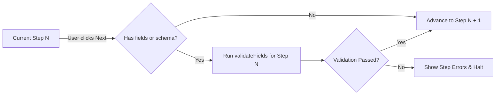

# RFC 005: Multi-Step & Wizard Form Workflows (NF-021)

- **Issue**: NF-021 / [ISSUE_BACKLOG.md](file:///d:/workspace/projects/native-form/docs/ISSUE_BACKLOG.md)
- **Status**: Proposed / Under Review
- **Target Version**: v0.7.0
- **Author**: Antigravity Core Team

---

## 1. Summary

This RFC specifies the architecture and API design for **Multi-Step and Wizard Forms** in Native Form.

Wizards (multi-step checkout flows, onboarding surveys, progressive disclosure forms) present unique challenges for DOM-first, uncontrolled form architectures. Because inputs in traditional uncontrolled architectures rely on DOM elements for state, conditionally unmounting step components can discard previously entered user data.

This RFC introduces:
1. **Step-Scoped Field Validation (`runtime.validateFields(names)`)**: Enables validating only the active step's fields before allowing the user to advance to the next step.
2. **Two Complementary Architectural Patterns**:
   - **Pattern 1: DOM-Preserved Steps (Recommended Zero-Overhead Mode)**: Retaining step fields in the DOM via HTML `<fieldset hidden>` or CSS `display: none`.
   - **Pattern 2: Memory-Preserved Hydration Mode (`preserveUnmounted: true`)**: Automatically snapshotting unmounted step values and re-hydrating them via default values when steps remount.
3. **Ergonomic React Hook (`useWizard`)**: Providing declarative step navigation, step validation gates, progress calculation, and completion state.

---

## 2. Motivation & Current Problems

### 2.1 The DOM Unmount Dilemma
In modern React development, wizards are commonly authored using conditional rendering:

```tsx
<form ref={form.formRef}>
  {step === 1 && <PersonalDetailsStep />}
  {step === 2 && <PaymentDetailsStep />}
  {step === 3 && <ReviewStep />}
</form>
```

When the user moves from Step 1 to Step 2, `<PersonalDetailsStep />` unmounts. In a purely uncontrolled form library, when an `<input>` is removed from the DOM, the browser destroys its internal value. When the user clicks "Back" to Step 1, all inputs are reset to empty.

### 2.2 Whole-Form vs. Step-Scoped Validation
Currently, `runtime.validate()` validates the entire form against the schema. If a user on Step 1 clicks "Next", running whole-form validation immediately fails because fields on Step 2 and Step 3 are not yet populated. 

Applications require a way to run validation on a targeted subset of fields:
```ts
const stepValid = await runtime.validateFields(["user.email", "user.password"]);
```

---

## 3. Core Runtime Primitives (`@native-form/core`)

### 3.1 Targeted Field Validation: `validateFields`

`RuntimePublicApi` is extended with `validateFields`:

```ts
export interface RuntimePublicApi<
  TValues extends NativeFormValues = NativeFormValues,
> {
  // ... existing methods
  /**
   * Validates a targeted subset of field names against the active pipeline/schema.
   * Updates error states only for the queried fields.
   */
  validateFields(
    fieldNames: readonly string[],
  ): Promise<ValidationResult<Partial<TValues>>>;
}
```

#### Execution Semantics:
1. Gathers current values from the form.
2. Runs the validation pipeline on the values.
3. Filters emitted issues to only those matching `fieldNames` (using normalized path resolution from RFC 003).
4. Sets or clears errors on the targeted fields without affecting untouched fields in subsequent steps.
5. Returns `{ success: boolean, issues: ValidationIssue[], values?: Partial<TValues> }`.

### 3.2 Preserved Unmounted Values Store

To support conditionally unmounted steps without losing data, `Runtime` gains an optional memory preservation layer:

```ts
export interface RuntimeOptions<
  TValues extends NativeFormValues = NativeFormValues,
> {
  // ... existing options
  /**
   * When true, preserves serialized values of fields that are removed from the DOM,
   * merging them into subsequent serializations and final submit.
   * @defaultValue false
   */
  preserveUnmountedValues?: boolean;
}
```

When a field is removed from the DOM:
- If `preserveUnmountedValues === false` (default): Field node and value are cleaned up per standard DOM lifecycle.
- If `preserveUnmountedValues === true`: The field's last known value is saved to `runtime.preservedValues`. When `runtime.serialize()` or `runtime.serializeFields()` is called, preserved values are merged with live DOM values.

---

## 4. Wizard Architecture Patterns

### Pattern 1: DOM-Preserved Steps (Native HTML-First, Zero Memory)

```tsx
function WizardForm() {
  const form = useForm({ schema: fullOrderSchema });
  const [currentStep, setCurrentStep] = useState(0);

  const handleNext = async () => {
    // Validate only Step 1 fields
    const res = await form.runtime.validateFields(["billing.name", "billing.email"]);
    if (res.success) {
      setCurrentStep((s) => s + 1);
    }
  };

  return (
    <form ref={form.formRef}>
      {/* Step 1 */}
      <fieldset hidden={currentStep !== 0} style={{ border: "none", padding: 0 }}>
        <input name="billing.name" />
        <input name="billing.email" />
        <button type="button" onClick={handleNext}>Next</button>
      </fieldset>

      {/* Step 2 */}
      <fieldset hidden={currentStep !== 1} style={{ border: "none", padding: 0 }}>
        <input name="shipping.address" />
        <button type="button" onClick={() => setCurrentStep(0)}>Back</button>
        <button type="submit">Complete Order</button>
      </fieldset>
    </form>
  );
}
```

> [!TIP]
> **Why Pattern 1 is Recommended for Most Applications**:
> - Zero memory overhead and zero hydration reconciliation.
> - Preserves native browser autofill, spellcheck, and undo stacks.
> - Accessibility: Screen readers understand hidden fieldsets through native HTML semantics (`hidden` attribute).

---

### Pattern 2: Memory-Preserved Hydration Mode (`useWizard`)

For applications where unmounting components is mandatory (e.g., heavily animated step carousels, complex step-specific 3D canvases, or memory-constrained devices):

```tsx
import { useForm, useWizard } from "@native-form/react";

function MultiStepApp() {
  const form = useForm({
    preserveUnmountedValues: true,
    onSubmit: (allValues) => {
      console.log("Full Wizard Submitted:", allValues);
    },
  });

  const wizard = useWizard({
    form,
    steps: [
      { id: "account", fields: ["account.username", "account.password"] },
      { id: "profile", fields: ["profile.fullName", "profile.avatarUrl"] },
      { id: "confirmation" },
    ],
  });

  return (
    <form ref={form.formRef}>
      {wizard.currentStep === 0 && (
        <div>
          <h2>Step 1: Account</h2>
          <input
            name="account.username"
            defaultValue={form.watch("account.username")}
          />
          <button type="button" onClick={wizard.next}>Next</button>
        </div>
      )}

      {wizard.currentStep === 1 && (
        <div>
          <h2>Step 2: Profile</h2>
          <input
            name="profile.fullName"
            defaultValue={form.watch("profile.fullName")}
          />
          <button type="button" onClick={wizard.prev}>Back</button>
          <button type="button" onClick={wizard.next}>Next</button>
        </div>
      )}

      {wizard.currentStep === 2 && (
        <div>
          <h2>Step 3: Review</h2>
          <pre>{JSON.stringify(form.watch(), null, 2)}</pre>
          <button type="button" onClick={wizard.prev}>Back</button>
          <button type="submit">Submit Everything</button>
        </div>
      )}
    </form>
  );
}
```

---

## 5. Specification for `@native-form/react` (`useWizard`)

### 5.1 API Signature

```ts
export interface WizardStepConfig {
  id: string;
  title?: string;
  fields?: readonly string[];
  schema?: SchemaLike;
}

export interface UseWizardOptions<TValues extends NativeFormValues = NativeFormValues> {
  form: UseFormResult<TValues>;
  steps: readonly WizardStepConfig[];
  initialStep?: number;
  onStepChange?: (fromStep: number, toStep: number) => void;
}

export interface UseWizardResult {
  currentStep: number;
  stepId: string;
  stepConfig: WizardStepConfig;
  totalSteps: number;
  isFirstStep: boolean;
  isLastStep: boolean;
  progress: number; // 0.0 to 1.0
  next(): Promise<boolean>;
  prev(): void;
  goTo(stepIndex: number): Promise<boolean>;
}
```

### 5.2 Navigation Logic & Guards



---

## 6. Security & Performance Considerations

1. **Memory Bounds**:
   `preserveUnmountedValues` must store only shallow values or deserialized primitives, avoiding storing circular references or orphaned DOM node handles.
2. **Prototype Pollution Protection**:
   Preserved values utilize RFC 003's hardened `setByPath` and `getByPath`, rejecting `__proto__`, `constructor`, and `prototype`.
3. **No Unnecessary Rerenders**:
   `useWizard` only rerenders when `currentStep` changes, not on each keystroke in the active step. Individual field rendering remains isolated via `useField`.

---

## 7. Implementation Plan

1. **RFC Review & Approval**: Align on `validateFields` and `preserveUnmountedValues` core signatures.
2. **Phase 1 (`@native-form/core`)**:
   - Implement `Runtime.validateFields(fieldNames)`.
   - Add unit tests in `packages/core/test/Runtime.test.ts`.
   - Implement `preserveUnmountedValues` option in `Runtime`.
3. **Phase 2 (`@native-form/react`)**:
   - Implement `useWizard` hook in `packages/react/src/useWizard.ts`.
   - Add integration tests in `packages/react/test/useWizard.test.tsx`.
4. **Phase 3 (Vite Studio Demo)**:
   - Add a Multi-Step Wizard demo tab in `examples/vite`.

